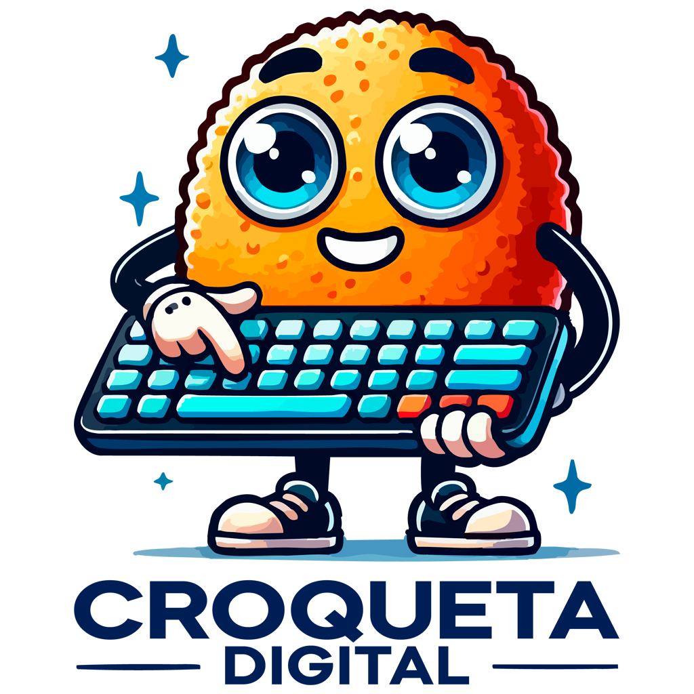

<p align="center">
  
</p>

<h1 align="center">Croqueta Digital NTFS Write on Mac</h1>

<p align="center">
  Lee <b>y escribe</b> discos NTFS (Windows) en tu Mac desde la barra de menús.<br>
  Gratis, de código abierto y sin suscripciones.
</p>

<p align="center">
  <a href="https://github.com/REMTOM/croqueta-ntfs-mac/actions/workflows/build.yml"></a>
  
  
  <a href="LICENSE"></a>
  <a href="https://croquetadigital.es"></a>
</p>

---

macOS solo sabe **leer** NTFS. Croqueta Digital NTFS Write on Mac detecta los discos NTFS al conectarlos y los vuelve a montar **con escritura** usando [macFUSE](https://macfuse.github.io/) y [ntfs-3g](https://github.com/tuxera/ntfs-3g), igual que harías con Paragon o Tuxera, pero con tu propio software.

## Funciones

- 🥟 Icono en la barra de menús con la lista de discos NTFS conectados.
- ⚡ **Montaje automático con escritura** al conectar el disco (desactivable).
- 📂 Abrir en Finder, desmontar y **expulsar con seguridad**.
- 🧼 No ensucia el disco: sin archivos `._` de macOS y solo nombres válidos en Windows.
- 👤 Los archivos quedan a nombre de tu usuario, no de root.
- 🔐 Helper privilegiado mínimo y una copia de ntfs-3g que solo root puede modificar (ver [Seguridad](#seguridad)).
- 🚀 Opción de abrirse al iniciar sesión.

## Requisitos

| | |
|---|---|
| macOS | 14 Sonoma o posterior (probado en macOS 27, MacBook Air M5) |
| Herramientas | Xcode o Command Line Tools (Swift 5.9+), [Homebrew](https://brew.sh) |
| Dependencias | macFUSE 5.x y ntfs-3g (`gromgit/fuse/ntfs-3g-mac`) |

> [!IMPORTANT]
> ntfs-3g usa libfuse2, y el backend **FSKit** de macFUSE solo funciona con libfuse3. Por eso hace falta la **extensión de núcleo** de macFUSE, que en Apple silicon obliga a poner el Mac en **Seguridad reducida**. Lee el paso 2 antes de empezar.

## Instalación

### 1. Dependencias

```bash
brew install --cask macfuse
brew tap gromgit/fuse
brew install gromgit/fuse/ntfs-3g-mac
```

### 2. Permitir la extensión de núcleo de macFUSE (solo Apple silicon, una vez)

1. Apaga el Mac. Mantén pulsado el botón de encendido hasta ver **"Cargando opciones de arranque"** → **Opciones** → **Continuar**.
2. **Utilidades → Utilidad de Seguridad de Arranque** → selecciona el disco → **Política de seguridad…**
3. Marca **Seguridad reducida** y **"Permitir la gestión por parte del usuario de extensiones de kernel de desarrolladores identificados"**. Reinicia.
4. Ejecuta `sudo /Library/Filesystems/macfuse.fs/Contents/Resources/load_macfuse`.
5. **Ajustes del Sistema → Privacidad y seguridad** → **Permitir** el software de *Benjamin Fleischer* → reinicia.

> [!WARNING]
> Con Seguridad reducida tu Mac admite extensiones de núcleo de terceros. Puedes volver a **Seguridad completa** cuando quieras con los mismos pasos (la escritura NTFS dejará de funcionar).

### 3. Instalar la app

```bash
git clone https://github.com/REMTOM/croqueta-ntfs-mac.git
cd croqueta-ntfs-mac
./install.sh
```

`install.sh` compila la app, la copia a `/Applications`, instala el helper y la copia protegida de ntfs-3g, y añade la regla de sudo. Te pedirá la contraseña de administrador.

## Uso

1. Conecta un disco NTFS. La croqueta de la barra de menús lo detecta y lo monta con escritura.
2. Desde el menú: **Abrir**, **Desmontar**, **Activar escritura** o **Expulsar**.
3. **Expulsa siempre antes de desconectar el disco.** Si lo quitas en caliente, el volumen puede quedar marcado como "sucio" y Windows tendría que repararlo.

> [!TIP]
> Si Windows se apagó con **inicio rápido** activado o en **hibernación**, ntfs-3g se niega a montar el disco con escritura para protegerlo. Desactiva el inicio rápido en ese PC (Panel de control → Opciones de energía) y apágalo del todo.

## Arquitectura

```
┌──────────────────────────────┐   sudo -n    ┌────────────────────────────┐
│ App SwiftUI (barra de menús) │ ───────────▶ │ croqueta-ntfs-helper (root)│
│ · DiskArbitration (eventos)  │              │ · valida diskXsY y NTFS    │
│ · lista volúmenes NTFS       │              │ · desmonta el RO de macOS  │
│ · usuario normal             │              │ · lanza ntfs-3g            │
└──────────────────────────────┘              └─────────────┬──────────────┘
                                                            ▼
                                 /Library/PrivilegedHelperTools/croqueta-ntfs/ntfs-3g
                                                            ▼
                                                macFUSE (kext) → /Volumes/<disco>
```

| Archivo | Función |
|---|---|
| `Sources/CroquetaNTFS/` | App SwiftUI: interfaz, detección de discos y llamadas al helper |
| `helper/croqueta-ntfs-helper` | Script root, solo admite `mount`/`unmount diskXsY` |
| `helper/empaquetar-ntfs3g.sh` | Copia ntfs-3g y sus librerías a una carpeta aislada y las reenlaza |
| `build.sh` | Compila y empaqueta la `.app` (sin sudo) |
| `install.sh` / `uninstall.sh` | Instalación y desinstalación completas |

## Seguridad

- La regla de sudo (`/etc/sudoers.d/croqueta-ntfs`) **solo** permite a tu usuario ejecutar `croqueta-ntfs-helper` sin contraseña. El helper lo instala root y nadie más puede modificarlo.
- El helper acepta solo identificadores `diskXsY`, comprueba que el volumen es NTFS y saca el nombre y el punto de montaje de `diskutil`, nunca de los argumentos.
- ntfs-3g **no** se ejecuta desde Homebrew, porque tu usuario puede modificar esa carpeta sin contraseña. `install.sh` copia una versión aislada a `/Library/PrivilegedHelperTools/croqueta-ntfs/`, y el helper se niega a usarla si algún archivo no es de root o alguien más puede escribir en él.
- Después de `brew upgrade ntfs-3g-mac`, vuelve a ejecutar `./install.sh` para usar la versión nueva.

¿Has encontrado una vulnerabilidad? Lee [SECURITY.md](SECURITY.md).

## Desinstalar

```bash
./uninstall.sh
```

Desmonta los volúmenes, borra la app, el helper, la copia de ntfs-3g y la regla de sudo. macFUSE y ntfs-3g de Homebrew no se tocan; el script te indica cómo quitarlos.

## Problemas frecuentes

| Síntoma | Solución |
|---|---|
| "Helper no instalado" | Ejecuta `./install.sh` |
| "sudo pide contraseña" | La regla de sudo falta o es de otro usuario: vuelve a ejecutar `./install.sh` |
| El volumen se monta y se desmonta solo a los pocos segundos | Se está usando FSKit: activa la extensión de núcleo (paso 2) |
| "ntfs-3g no pudo montar (¿kext de macFUSE…?)" | La extensión de núcleo no está permitida o no está cargada (paso 2) |
| Windows hibernado / inicio rápido | Desactiva el inicio rápido en Windows |
| El USB aparece como bloqueado | Revisa el antivirus (p. ej. el Control de dispositivos de ESET) y **Ajustes → Privacidad y seguridad → Permitir accesorios** |

## Licencia

Código bajo licencia [MIT](LICENSE). El logo y la marca **Croqueta Digital** **no** entran en la licencia MIT (ver [NOTICE.md](NOTICE.md)).

Este proyecto **no distribuye** ntfs-3g (GPL-2.0) ni macFUSE: se instalan por separado con Homebrew.

---

<p align="center">Hecho con 🥟 por <a href="https://croquetadigital.es"><b>Croqueta Digital</b></a> · <a href="https://croquetadigital.es">croquetadigital.es</a></p>
